<!-- BEGIN animated project showcase -->
<picture>
  <source media="(prefers-reduced-motion: reduce) and (max-width: 600px)" srcset=".github/showcase/still-terminal-overview-mobile.svg">
  <source media="(prefers-reduced-motion: reduce)" srcset=".github/showcase/still-terminal-overview.svg">
  <source media="(max-width: 600px)" srcset=".github/showcase/terminal-overview-mobile.svg">
  
</picture>
<!-- END animated project showcase -->

# Rifatur Rahman — portfolio

An original editorial portfolio for a full-stack developer and AIUB CSE student. Eight independent destinations, near-black surfaces, restrained electric blue, self-hosted type, and project-specific technical visuals. Home is a focused landing experience; other content appears only on its own route.

**Website:** https://rifatur17.github.io/

**Repository:** https://github.com/rifatur17/rifatur17.github.io

## Develop

Requires Node.js 24 and npm. This is a static React + Vite + TypeScript site; no backend, credentials, or environment file is needed.

```sh
npm ci
npm run dev
```

Edit profile, skills, research, and project metadata in `src/data.ts`. Route metadata lives in `src/routes.ts`; page content in `src/Pages.tsx`; navigation and route effects in `src/App.tsx`; reusable content in `src/Shared.tsx`; technical illustrations in `src/Visuals.tsx`. Design tokens and responsive rules are in `src/styles.css`. Fonts are bundled from Fontsource, not requested from a third-party CDN at runtime.

## Routes and refresh behavior

`/`, `/about/`, `/skills/`, `/projects/`, `/research/`, `/leadership/`, `/education/`, `/contact/`.

React Router uses the browser History API for navigation and Back/Forward. Each route renders only its own page. Navigation updates the active link, document title, canonical/social metadata, scroll position, and heading focus. The homepage's Explore Portfolio hint opens Projects. Footer next-page links provide a complete journey through all eight destinations, alongside the Home link.

After Vite builds, `scripts/static-routes.ts` generates a real `dist/<route>/index.html` for every destination with its own initial SEO metadata and an eight-URL sitemap. GitHub Pages can serve direct links and refreshes without a redirect shim or pretending missing pages are HTTP 200. Directory URLs use a trailing slash; GitHub Pages redirects slashless directory requests. A generated `404.html` lets unknown destinations display a useful Home link while retaining the server's real 404 response.

When adding routes, update the shared route registry, route component mapping, and browser coverage. No GitHub Pages server rewrite configuration is required.

## Verify

```sh
npm run lint
npm run typecheck
npm run build
npm audit
npm test
```

Local browser tests use installed Google Chrome. CI uses Playwright Chromium. If Chrome is unavailable locally, first run `npx playwright install chromium` and change the local `channel` in `playwright.config.ts` to use that browser instead. Test outputs are ignored by Git.

Tests cover four viewport widths (1440, 834, 390, 320): each page's direct access and refresh, actual static HTML metadata, active navigation, Back/Forward without document reload, heading focus, mobile menu/Escape, reduced motion, overflow, image decoding, contact/project destinations, exact CV/photo bytes, sitemap, unknown destinations, and automated WCAG A/AA checks on all eight pages. Automated accessibility checks cannot establish complete accessibility or every assistive-technology interaction.

Run the same checks against a deployed site in PowerShell:

```powershell
$env:PLAYWRIGHT_BASE_URL = 'https://rifatur17.github.io'
npm test
Remove-Item Env:PLAYWRIGHT_BASE_URL
```

## Deploy

GitHub Pages is configured to use GitHub Actions. Pushes to `main` run lint, TypeScript/build, a full npm audit, and browser checks before uploading `dist/` and deploying. Pull requests run verification without deploying. Actions are pinned to immutable commit hashes. Vite's base is `/` for the account's root Pages domain.

No source CV, other project repository, or original project history is modified by this site. See [content sources](docs/content-sources.md) for provenance and contribution boundaries.

## Assets and content

- `public/assets/Rifatur_Rahman_CV.pdf` is an unchanged copy of the latest supplied CV.
- Home and About use the explicitly selected blazer portrait (`rifatur-professional-portrait.jpg`, about 174 KB), copied byte-for-byte. CSS adapts its framing without altering the original. The outdoor photo and earlier CV portrait are retained as available assets. Home prioritizes its portrait request; other destinations load only when visited. About also offers the exact supplied CV download.
- The StockPilot preview is an actual screenshot captured with isolated test data.
- IncidentLens, hospital, and orbital figures are original labeled illustrations, not fake screenshots.
- IncidentLens retains upstream authorship; its demo is explicitly the upstream deployment.
- Research figures are reported from the supplied manuscript and analysis; no publication acceptance is claimed.

Font licenses are included in the installed Fontsource packages. Lucide icons are ISC licensed. Portfolio photographs, CV, and personal research content remain their respective owners' materials.
